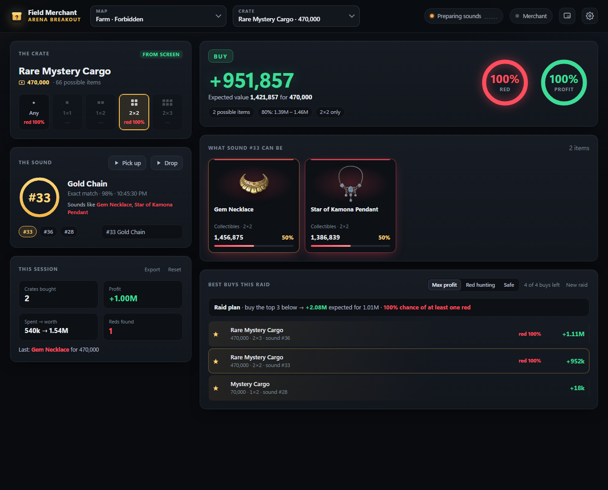

# ABI Field Merchant Companion

A free, open-source helper for the **Field Merchant** in *Arena Breakout: Infinite*. When you drag a mystery crate,
the game plays the pick-up sound of the item inside. This app hears that sound, works out which items it could be,
and shows you the real odds, the chance of a red item, the expected value, and a **BUY / GAMBLE / SKIP** verdict.

> [!WARNING]
> **Unofficial fan project. Not affiliated with, endorsed by, or sponsored by MoreFun Studios, Tencent, or anyone
> else involved with Arena Breakout: Infinite.**
>
> **There is no guarantee you won't be banned.** The app was designed to stay hands-off the game (see
> [Is it safe?](#is-it-safe)), but the game's developers decide what their anti-cheat flags and what their rules
> allow, and they can change that at any time. Use it **at your own risk**. The author(s) are not responsible for
> bans, suspensions, lost items or any other consequence of using it. Read the full [Disclaimer](#disclaimer).

## Contents
- [What it does](#what-it-does)
- [Download and run](#download-and-run)
- [How to use it](#how-to-use-it)
- [How it works](#how-it-works)
- [How accurate is it?](#how-accurate-is-it)
- [Is it safe?](#is-it-safe)
- [Privacy](#privacy)
- [Credits](#credits)
- [Disclaimer](#disclaimer)
- [License](#license)

## What it does
- **Identifies the crate's sound** when you drag it, and lists every item that crate can contain with that sound.
- **Real odds** for each item, from the game's merchant data (not guesses).
- **Red chance, expected value and a verdict** (BUY / GAMBLE / SKIP), plus a likely value range.
- **Reads the merchant screen** for crate type, price and size, so you don't have to pick them by hand (early version).
- **Raid plan**: ranks the crates you've looked at by profit, red chance or safety.
- **Mini window** that stays on top, a session summary, and CSV export of your purchases.
- **Stays current**: when abibuilder.com publishes new merchant data (new season, new items), the app offers to switch to it.

## Download and run
1. Download `ABI-Field-Merchant.exe` from the [Releases](../../releases) page. Each release lists the file's SHA-256
   checksum so you can check the download.
2. Put it in a normal folder, such as `Documents\ABI Field Merchant`, and double-click it.
3. Windows may say *"Windows protected your PC"* because the app isn't code-signed. Click **More info → Run anyway**.
   All of the source code is in this repository if you'd rather read it or build the exe yourself
   (see [docs/TECHNICAL.md](docs/TECHNICAL.md)).

**You need:** Windows 11 (Windows 10 works if you pick an output device under ⚙), Google Chrome or Microsoft Edge,
and the game in **borderless window** mode for screen reading.

**Nothing is installed.** Settings and caches live in `%LOCALAPPDATA%\ABIFieldMerchant`. To remove the app, delete that
folder and the exe.

## How to use it
1. Start the app, then the game. The app listens only while Arena Breakout is running.
2. Pick your **map** and the **crate** (type and price), or let the app read them from the screen.
   If you know the crate's **size**, pick it too: it narrows the possible items a lot.
3. **Drag the crate** in the merchant screen. The sound and the possible items appear by themselves, with the
   chance of each and a verdict.
4. Not sure? Use **▶ pick up / ▶ drop** to play the real sound and compare by ear, or pick the sound yourself.

The app lives in the system tray. Right-click the tray icon and choose **Exit** to close it.

## How it works
In plain terms, there are three parts.

**1. Listening.** Every item in the game has its own pick-up sound, and many items share the same one. The app
captures **only the game's audio** through the same Windows feature that OBS and Discord use for app audio. It
ignores your microphone, Discord and music. When it hears a short, sharp sound, it compares it with the game's real
item sounds (downloaded from abibuilder.com) and with in-game recordings from the abi-merchant-helper project. It
only shows a result when the match is clear. Gunshots, footsteps and voice chat are ignored.

**2. Looking.** While the merchant screen is open, the app takes screenshots of the game window, the way any
recording app does, and uses Windows' built-in text recognition (OCR) to read the crate's name and price (on a sale,
both the sale price you pay and the original price the odds are listed under). It measures the crate's outline on
the grid to get its size, and notices which crate you grab, so the sound is matched to the right one. It also reads the purchase line, so your buys can be logged
automatically. This part is still an early version.

**3. Calculating.** abibuilder.com publishes the merchant's loot tables: for each map and crate, which loot groups
it rolls, which items are in each group, and how likely each one is. The app takes the crate you're looking at,
keeps only the items that make the sound it heard (and fit the size, if known), and works out each one's chance.
Real purchases, both your own and the public purchase base from abi-merchant-helper, fine-tune those odds. From
that it calculates the red chance, the expected value and the verdict.

Want the details (sound matching, thresholds, endpoints, file layout)? See [docs/TECHNICAL.md](docs/TECHNICAL.md).

## How accurate is it?
- **Sound recognition** is tested with a built-in accuracy test (`tools/eval.html`). On the latest run, 321 of 321
  test cases were right, with 0 wrong and 0 false alarms from other sounds or voice chat.
- **The odds are probabilities, not promises.** Many items share the same pick-up sound, so the app can often
  narrow a crate down to a few items but not one. A 30% red chance still means 70% of the time it isn't red.
- The odds are only as good as the published merchant data. If the game changes its loot tables before
  abibuilder.com updates, the numbers can be off.
- Screen reading is an early version and may misread crates. You can always pick them by hand.

## Is it safe?
The app was built to behave like a **streaming or recording app**, never like a cheat:

| The app does NOT | The app only |
|---|---|
| open the game process or read/write its memory | captures the game's audio through the Windows audio service (like OBS and Discord) |
| inject anything into the game or change game files | takes screenshots of the game window (like any recorder) |
| draw anything on top of the game | reads the window position and mouse cursor with read-only Windows functions |
| send keys or mouse clicks to the game | shows its results in its **own** window |

Even so, **we can't promise you won't be banned.** Only the game's developers decide what is allowed, and the way
they enforce that can change. If you're unsure, check the game's Terms of Service, or don't use the app.

## Privacy
- The app connects only to **abibuilder.com** (merchant data and item sounds), **hexaov91.github.io** (item
  pictures), and **raw.githubusercontent.com** (abi-merchant-helper's recordings and its public, read-only
  purchase base).
- **It uploads nothing.** Your purchases, settings and F8 screenshots stay on your PC in `%LOCALAPPDATA%\ABIFieldMerchant`.
- It has no account, no telemetry and no ads.

## Credits
This app stands on the work of others.

- **[abibuilder.com](https://abibuilder.com/merchant)**: the merchant loot tables (crates, loot groups, items, odds,
  sizes and values) and the game's item sounds. Without that data, this app could not exist.
- **[hexaov91 / abi-assets](https://github.com/hexaov91/abi-assets)**: the item pictures (linked from abibuilder's data).
- **[neverh8me / abi-merchant-helper](https://github.com/neverh8me/abi-merchant-helper)** (GPL-3.0): the project that
  showed this was possible. Many of this app's ideas come from it: splitting sounds into frequency bands to match
  them, matching pick-up sounds only, extra caution for the desk-clock sound, using crate size to break ties, market
  vs. hand-in value, red chance, alert chimes, refining odds with real purchases, and the merchant-screen reading
  approach. These ideas were **reimplemented from scratch; no code was copied.** The app also downloads 5 of
  their in-game sound recordings and their public purchase base at runtime.
- **Arena Breakout: Infinite** by MoreFun Studios / Tencent: the game, and all game names, data, sounds and images
  shown in the app, belong to their owners.
- Built with the help of [Claude Code](https://claude.com/claude-code).

See [NOTICE.md](NOTICE.md) for the full third-party notices.

## Disclaimer
- This is an **unofficial, fan-made project**. It is **not affiliated with, endorsed by, sponsored by, or approved by**
  MoreFun Studios, Tencent, or any other company involved with Arena Breakout: Infinite.
- **No guarantee against bans or account action.** The app is designed not to interact with the game process, but
  the game's developers alone decide what their anti-cheat detects and what their Terms of Service allow, and they
  can change both at any time. **You use this app entirely at your own risk.**
- The odds, values and verdicts are **estimates** based on public data, not guarantees of what a crate contains.
- The software is provided **"as is", without warranty of any kind** (see [LICENSE](LICENSE)). The author(s) and
  contributors are **not liable** for any ban, suspension, loss of in-game items or currency, or any other damage
  arising from its use.
- All trademarks, game content and assets belong to their respective owners.

## License
The source code is free and open source under the [MIT License](LICENSE). Anyone may use, change and share it, even
commercially, as long as the license notice is kept.

The license covers only this project's own code. Game data, sounds, pictures, and material from abibuilder.com and
abi-merchant-helper belong to their owners and are **not** covered. See [NOTICE.md](NOTICE.md).
